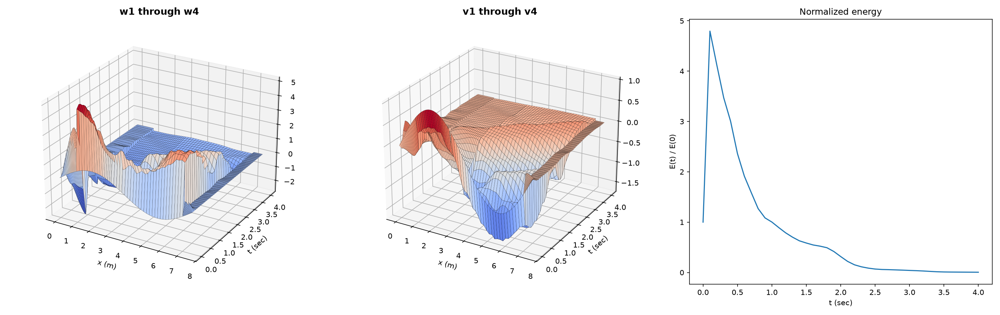

# transmission-line-waves

A nanobind-wrapped C++ solver for a 4-segment transmission-line wave equation, with a Python driver script for plotting.



## Quick start (Docker)

You only need Docker. Run this in any folder:

```
docker run --rm -v "$PWD:/out" ghcr.io/jacobwalterman/transmission-line-waves sin /out/sin.png
```

This saves `sin.png` in your current folder. The first argument is the initial condition (`box`, `flat`, or `sin`) and the second is where to save the plot.

On Fedora or other SELinux systems, add `:z` to the volume: `-v "$PWD:/out:z"`.
If your Docker setup needs it, put `sudo` in front.

## Install with pip (no Docker)

Needs Python 3.10+, a C++ compiler, and CMake.

```
pip install git+https://github.com/jacobwalterman/transmission-line-waves
python python/run_transmission_line.py [box|flat|sin] [out_path.png]
```

The script defaults to `box` and `transmission_line.png`.

## Local development (Nix)

Requires [Nix](https://nixos.org/) and [direnv](https://direnv.net/).

```
direnv allow
```

This enters the flake's dev shell (compiler, CMake, Eigen, Python) and creates and activates a project-local venv automatically. Then, once per checkout and again after changing any C++ source:

```
pip install .
```

Run the solver the same way as above:

```
python python/run_transmission_line.py [box|flat|sin] [out_path.png]
```

## Building the Docker image yourself

```
docker build -t transmission-line-waves:dev .
docker run --rm -v "$PWD:/out:z" transmission-line-waves:dev box /out/box.png
```

## Troubleshooting

If the bind mount gives you permission errors, copy the output out of the container instead:

```
docker run --name tlw-run transmission-line-waves:dev
docker cp tlw-run:/app/transmission_line.png ./transmission_line.png
docker rm tlw-run
```

To change the initial condition or filename this way:

```
docker run --name tlw-run transmission-line-waves:dev sin /app/custom.png
docker cp tlw-run:/app/custom.png ./custom.png
docker rm tlw-run
```
